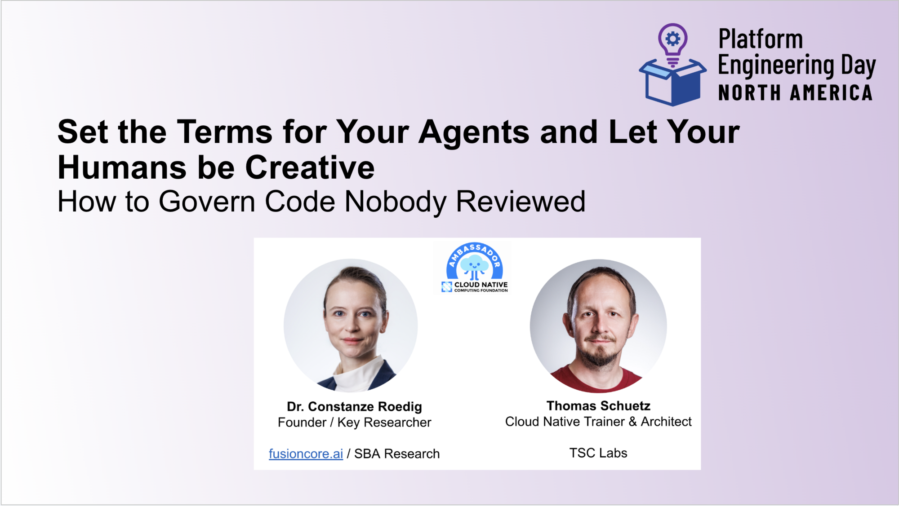

# Governing agent-written code
{: .no_toc }

An ADR compliance harness for workloads written by AI coding agents, built on this stack.
{: .fs-6 .fw-300 }

[](https://www.youtube.com/watch?v=VDq69KCwSo8)

**Watch the talk:** [Set the Terms for Your Agents and Let Your Humans Be Creative: How to Govern Code Nobody Reviewed](https://www.youtube.com/watch?v=VDq69KCwSo8), Thomas Schuetz and Dr. Constanze Roedig, Platform Engineering Day, KubeCon + CloudNativeCon North America 2026 (CNCF channel on YouTube).

## In short

A coding agent wrote and deployed an application in 13 iterations on 5 and 6 November 2026. Its code was not reviewed line by line. After each deployment the harness checked the running system against the platform team's architecture decision records (ADRs) and sent the findings back to the agent. In the first iteration 9 of 16 ADRs were violated; in the last, 3 of 25. None of those three belongs to the application.

## How it works

- The platform team writes ADRs, for example "no plaintext on the wire". Each ADR is tied to checks: at admission, on the pod spec, at runtime (eBPF), and on the network (Pixie).
- The coding agent deploys. The harness waits until the pods are warm, puts load on the application, and decides per ADR: `VIOLATED`, `COMPLIANT` or `NOT_OBSERVED`. No observation, no finding, and no observation, no pass.
- Each finding names the observed event, the decision it broke and the fix. It goes back to the coding agent, which changes its code and manifest and deploys again.
- Findings are written to the ClickHouse table `forensic_db.adr_findings`; `pxl/adr_findings.pxl` in the repository shows them in the cockpit. The same evaluator is available to the agent as an MCP server.

## What runtime and network evidence found

The pod spec and the static checks passed in each of these cases:

- **Plaintext between tiers.** Pixie recorded unencrypted HTTP from the frontend to the backend. The backend moved to TLS.
- **Capabilities in the database container.** The container had dropped all capabilities, yet the sensor saw `CAP_SETUID` and `CAP_SETGID` used by the image entrypoint. The agent changed how PostgreSQL starts.
- **Personal data leaving the namespace.** E-mail addresses appeared in decrypted traffic to peers outside the namespace.

The three violations left at the end: a gap in the platform's own tier profile, image provenance (accepted by the platform as a risk), and known vulnerabilities in base and third-party images.

## Try it

The harness is in [k8sstormcenter/commons-grid-dynamics-manifest](https://github.com/k8sstormcenter/commons-grid-dynamics-manifest). It needs this stack ([Install](install.html)), Kyverno, cert-manager and an identity provider. One iteration:

```sh
./harness/loop.sh <N> <namespace> <manifest>
```

{: .warning }
The committed manifests do not run unchanged on another cluster: the application images and the TLS tap image are private, and some values are specific to the original cluster. The TLS tap (`platform/dx-ktls-openssl.yaml`) is a privileged proof of concept that stores decrypted request and response bodies; remove it when you are done.

## Links

- Video: [Set the Terms for Your Agents and Let Your Humans Be Creative](https://www.youtube.com/watch?v=VDq69KCwSo8) (CNCF, YouTube)
- Session: [sessionize](https://cncf-hosted-co-located-events-north-america-2026.sessionize.com/session/1255381), Platform Engineering Day, Salt Lake City, 9 November 2026
- Harness and manifests: [k8sstormcenter/commons-grid-dynamics-manifest](https://github.com/k8sstormcenter/commons-grid-dynamics-manifest)
