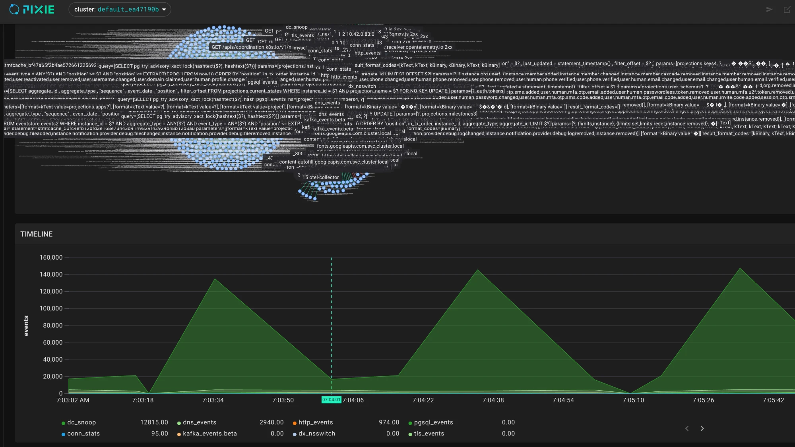
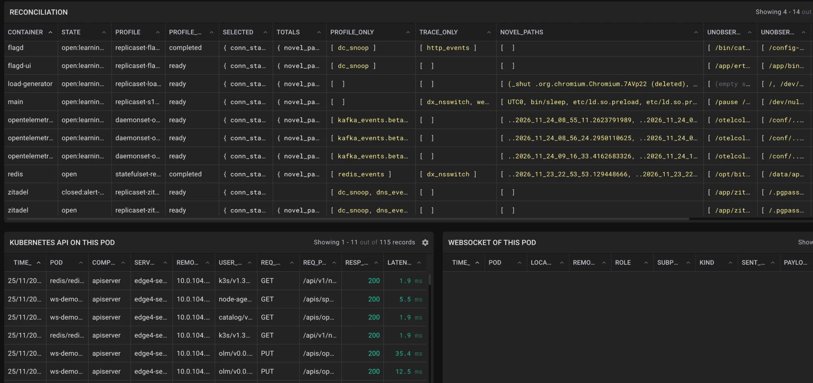
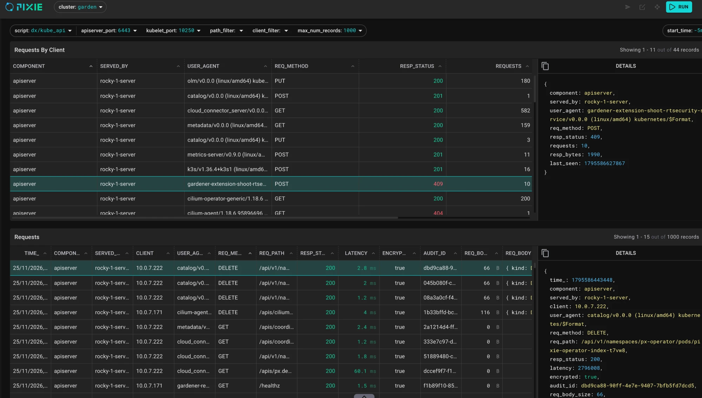
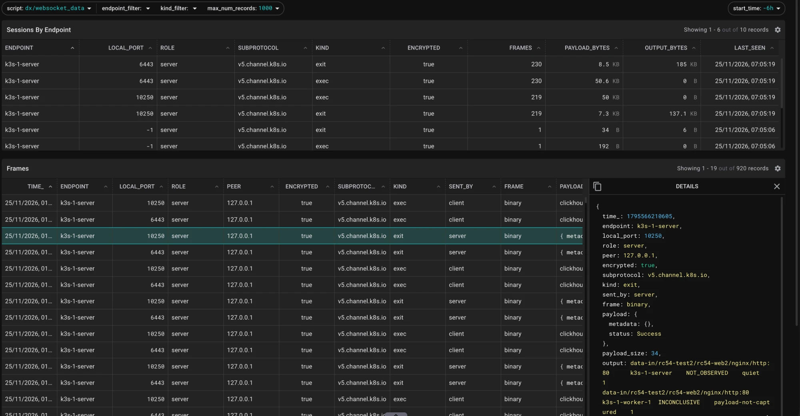
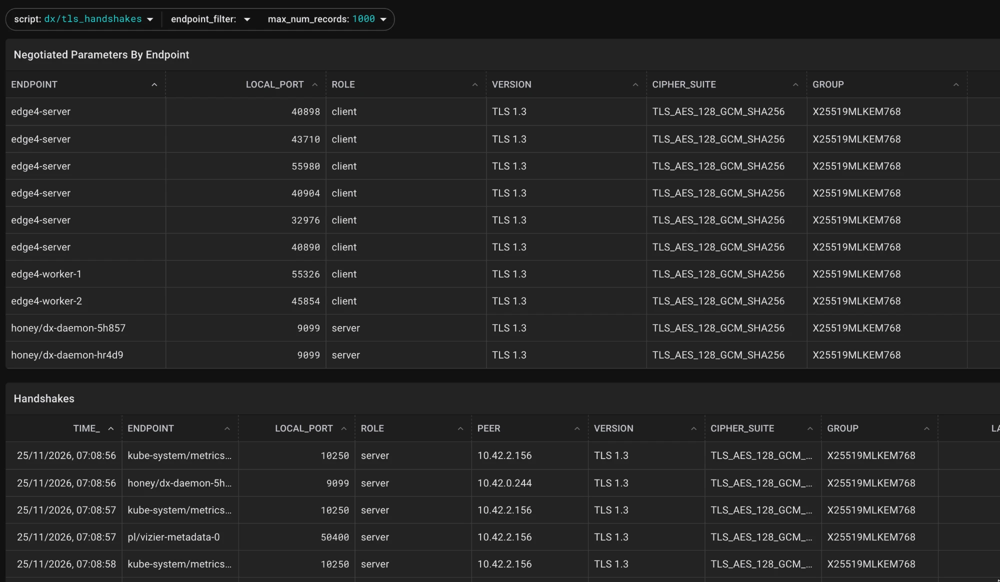

# Cockpit views
{: .no_toc }

1. TOC
{:toc}

The cockpit is the Pixie UI in your browser. The SOC views are PxL scripts named `dx/<name>`; pick them in the **script** menu at the top left. Views that read the ClickHouse database in your cluster take a `clickhouse_dsn` argument.

The time range is set by `start_time` at the top right. Most views show the last 6 hours. Exceptions: Evidence Graph and Proof Coverage show 7 days, Full-Chain 90 minutes, Process Forest 1 hour, Kubernetes API traffic and TLS handshakes 5 minutes.

## A typical investigation

1. An alert fires and dx opens an order.
2. Open **Host findings** (`dx/host_findings`) and pick a host or an order.
3. Open **Shadow Trace** (`dx/shadow_trace`) with an empty `shadow_id` to list all traces. Pick the trace of the flagged container and click its link (see [below](#shadow-traces-first-all-then-one)).
4. Check what the pod did through the Kubernetes API and over TLS: `dx/kube_api`, `dx/websocket_data`, `dx/tls_handshakes`.

## Shadow traces: first all, then one

Open `dx/shadow_trace` with `shadow_id` left empty, for example:

```
https://work.soc.k8sstormcenter.com/live/clusters/garden?clickhouse_dsn=forensic_analyst%3Achangeme-analyst%40clickhouse-forensic-soc-db.clickhouse.svc.cluster.local%3A9000%2Fforensic_db&container=&graph_leave_out=stack_trace&leave_out=stack_trace&live_window=-30m&script=dx%2Fshadow_trace&shadow_id=&start_time=-5m
```

The **Shadows** table then lists every trace: when it opened, the last epoch, pod, container, rogue state, state, profile, workload kind, host and shadow ID.

Click the link in the `trace` column of one row. The view opens again with that `shadow_id` set, and every panel shows only that trace:

- a behaviour graph and a timeline of events per data source (process events, DNS, HTTP, PostgreSQL, connection statistics, Kafka, namespace switches, TLS);
- the reconciliation against the container's profile: profile status, which data sources were selected, what appears only in the profile, what appears only in the trace, new paths, and execs and opens the profile allows that were not observed;
- namespace switches, processes and the process forest;
- the protocol rows captured for the trace (HTTP, DNS, connections, Redis, PostgreSQL, MySQL, AMQP, Kafka, Cassandra, MongoDB) and stack traces;
- the Kubernetes API requests and the WebSocket sessions of the pod.


*Shadow Trace: behaviour graph and timeline. The legend under the timeline lists the data sources.*


*Shadow Trace: reconciliation against the profile, and below it the Kubernetes API requests and WebSocket sessions of the pod.*

## Kubernetes API traffic

The SOC now records the traffic to the Kubernetes API. `dx/kube_api` shows the requests served by the API server (port 6443) and by the kubelets (port 10250). Both ports are arguments, for clusters that use others.

- **Requests By Client:** requests grouped by component (`apiserver` or `kubelet`), the pod or node that served them, user agent, method and status, with the number of requests, the response bytes and when the last one was seen.
- **Requests:** each request with time, component, client (pod name if known, otherwise the IP address), user agent, method, path, status, latency, whether it was encrypted, the audit ID, and the request and response bodies and headers. The audit ID is the one the API server returns, so you can find the same request in the API server's audit log.

Filter with `path_filter` (part of the path) and `client_filter` (part of the user agent or the client address). Headers and bodies are shown as captured.


*`dx/kube_api`: requests to the API server, grouped by client and one by one. The details pane on the right shows the selected row.*

## Commands run through the Kubernetes API

`dx/websocket_data` shows WebSocket sessions to the API server and the kubelets, for example `kubectl exec` with the subprotocol `v5.channel.k8s.io`.

- **Sessions By Endpoint:** endpoint, port, role, subprotocol, kind (`exec`, `exit`), whether encrypted, number of frames, payload bytes, output bytes, last seen.
- **Frames:** each frame with time, endpoint, port, role, peer, subprotocol, kind, who sent it (client or server), frame type, payload and output. Select a row to read the whole frame in the details pane.

Filter with `endpoint_filter` and `kind_filter`.


*`dx/websocket_data`: exec sessions and their frames. The details pane shows what a command returned.*

## TLS handshakes

`dx/tls_handshakes` shows the TLS version, cipher suite and key-exchange group negotiated on each connection.

- **Negotiated Parameters By Endpoint:** per endpoint, port and role: version, cipher suite and group.
- **Handshakes:** each handshake with time, endpoint, port, role, peer, version, cipher suite, group, latency, what the client offered and what the server chose.

Use it to find connections that still use TLS 1.2 or a key exchange without ML-KEM. In the screenshot, every handshake uses TLS 1.3 with the hybrid key exchange `X25519MLKEM768`.


*`dx/tls_handshakes`: negotiated parameters per endpoint and single handshakes.*

## All views

### Start here
{: .no_toc }

| View | What it shows | Use it to |
|---|---|---|
| **Host findings** `dx/host_findings` | A graph from MITRE tactic to pod; per host the number of findings, when it was last seen, and links to Presentation, Shadow profiles and Rogue state; a list of findings with process details and a link to each order's evidence graph. | Start after an alert: pick a host or an order. |
| **Incidents** `dx/incidents` | Orders per pod and rule. | Count what produced orders. |
| **SOC Full-Chain** `dx/fullchain` | The attack-chain graph around pods that have a link of severity 5 or more, with labels per pod. | See the whole chain around high-severity pods. |

### One order or case
{: .no_toc }

| View | What it shows | Use it to |
|---|---|---|
| **SOC Evidence Graph** `dx/evidence_graph` | Everything for one order or case: case and evidence graphs with MITRE labels, the orders, the raw alerts, the protocol rows captured for the order, stack traces, proof coverage with verdicts. Arguments: `order_id`, `case_id`, `investigation_id`. | Open from an order link. |
| **SOC DNS Resolution** `dx/dns_resolve` | Which pod asked which resolver for which name, in one order's time window. Needs `order_id`. | Check name lookups around an alert. |
| **Presentation** `dx/breakout` | For one host: a graph from pod to alert destination, alert counts, and a time-ordered alert list with process details. Also all HTTP POST requests with bodies (this table is not filtered by host). | Walk through one host's alerts in order. |
| **SOC Proof Coverage** `dx/proof_coverage` | Proof coverage per suspicion with GAP markers; coverage per class; age of the last measurement. | Find suspicions without proof. |

### Flagged containers and profiles
{: .no_toc }

| View | What it shows | Use it to |
|---|---|---|
| **SOC Shadow Trace** `dx/shadow_trace` | With `shadow_id` empty: all traces. With one `shadow_id`: behaviour graph, timeline, reconciliation against the profile, namespace switches, processes, protocol rows, Kubernetes API requests and WebSocket sessions of that trace. | See everything a flagged container did and how it differs from its profile. |
| **Rogue state** `dx/rogue_state` | Containers flagged as rogue: phase, when firing started and stopped, snapshots; what fires now per namespace; a graph by phase. | Follow a flagged container over time. |
| **Shadow profiles** `dx/shadow_profiles` | The current learned profile per container: execs, opens, outgoing and incoming connections, system calls, capabilities. The time range does not filter it. | Read what the sensor learned for a container. |
| **Profile compare** `dx/profile_compare` | Profiles you wrote next to the learned ones, counts by pairing, and the differences per field (always the last 720 hours). Read only. | See where behavior differs from the profile you wrote. |
| **Profile coverage** `dx/profile_coverage` | Per namespace: containers governed by profiles you wrote (signed and unsigned) and rogue artifacts. | Find containers without a profile. |
| **Signatures** `dx/signatures` | Per profile: whether it is signed and by whom; the trusted signer keys and the paths they may sign. | Check who vouches for a profile. |
| **SOC Process Forest** `dx/process_forest` | Per container: process, exec and exit counts and how processes were tied to the pod; a parent-to-child graph, a per-minute timeline, process and exec tables. Filters: namespace, pod, command, scope. | Follow the process tree of a container. |

### Kubernetes API and TLS
{: .no_toc }

| View | What it shows | Use it to |
|---|---|---|
| **Kubernetes API Traffic** `dx/kube_api` | Requests served by the API server and the kubelets, grouped by client and one by one. | See who called the API, with which path, status and body. |
| **WebSocket** `dx/websocket_data` | WebSocket sessions such as `kubectl exec`, and their frames with payload and output. | Read commands run in pods and what they returned. |
| **TLS Handshakes** `dx/tls_handshakes` | TLS version, cipher suite and key-exchange group per connection. | Find connections with old TLS versions or groups. |

### Narrow views
{: .no_toc }

| View | What it shows |
|---|---|
| **Discharge** `dx/discharge` | Outgoing HTTP POST requests: pod, remote address, path, status, body. |
| **External contacts** `dx/external_contacts` | Domain names that appear in alerts, per pod. |
| **Token access** `dx/token_access` | Alerts about reads of service account tokens, per pod and process. |
| **MITRE coverage** `dx/mitre_coverage` | Alerts per MITRE ATT&CK tactic and technique. |

## Write your own views

The views above are a starting point. Write the views you need with your AI coding agent.

- A view is a folder with three files: `manifest.yaml` (name and description), `<name>.pxl` (the queries) and `vis.json` (the arguments with their default values, and the tables and graphs).
- Give your agent one of the folders in [`src/pxl_scripts/dx/`](https://github.com/k8sstormcenter/pixie/tree/release-cut-v0081/src/pxl_scripts/dx) as an example, the tables it may read (the Pixie tables, and the ClickHouse tables on [Evidence](evidence.html)), and your question.
- Try the script before you deploy it: `px run -f <name>.pxl`, or open the script editor in the Pixie UI with ctrl+e (cmd+e on a Mac) and paste the PxL script and the vis spec.
- Self-host your own Pixie cloud. Then you decide which views it serves: a few minutes after you add one, it is in the script menu with your default values and filters.

Pixie documentation: [PxL reference](https://docs.px.dev/reference/pxl/), [writing PxL scripts](https://docs.px.dev/tutorials/pxl-scripts/write-pxl-scripts/), [self-hosted Pixie](https://docs.px.dev/installing-pixie/install-guides/self-hosted-pixie/).

## Where the views come from

The views are in [`src/pxl_scripts/dx/`](https://github.com/k8sstormcenter/pixie/tree/release-cut-v0081/src/pxl_scripts/dx) of the k8sstormcenter Pixie fork. The views for Kubernetes API traffic, WebSocket sessions and TLS handshakes, and the Kubernetes API and WebSocket panels in Shadow Trace, are newer than that branch. The screenshots on this page were taken in the SOC cloud on 25 November 2026.
