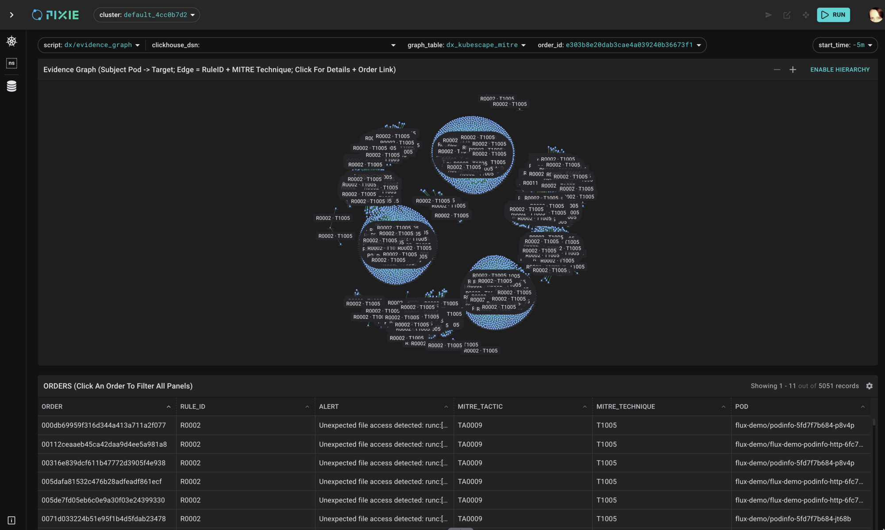
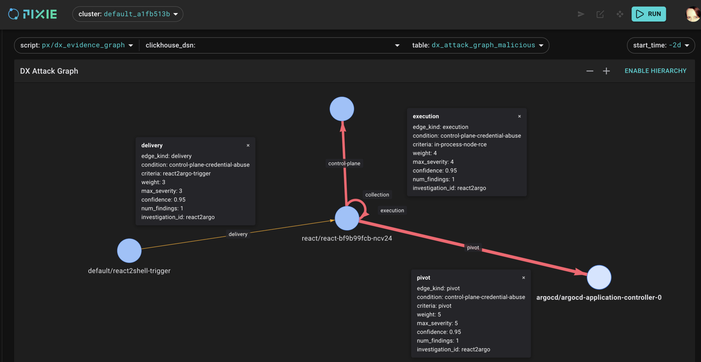
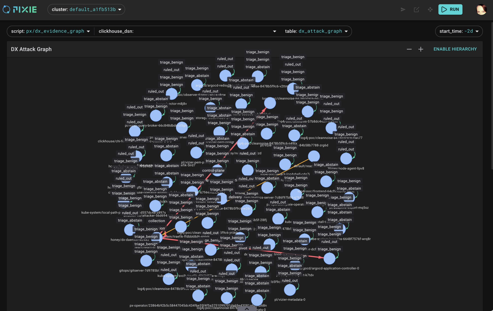

# Cockpit views
{: .no_toc }

1. TOC
{:toc}

The cockpit is the Pixie UI in your browser. The SOC views are PxL scripts named `dx/<name>`; pick them in the **script** menu at the top left. Each view reads the ClickHouse database in your cluster through its `clickhouse_dsn` argument.

The time range is set by `start_time` at the top right. Most views show the last 6 hours. Exceptions: Evidence Graph and Proof Coverage show 7 days, Full-Chain 90 minutes, Process Forest 1 hour.

## A typical investigation

1. An alert fires and dx opens an order.
2. Open **Host findings** (`dx/host_findings`) and pick a host or an order.
3. Follow the order link to **Evidence Graph** (`dx/evidence_graph`). Read the graph, the protocol rows, the stack traces and the proof verdict.
4. If a container is flagged, open **Shadow Trace** (`dx/shadow_trace`) to see everything it did and how that differs from its profile.
5. After a test run, open **KPI Proof** (`dx/kpi_proof`) to read the detection rates.

*Evidence Graph. Top: pods linked by rule and MITRE technique. Bottom: the orders; clicking one filters all panels.*

## Start here

| View | What it shows | Use it to |
|---|---|---|
| **Host findings** `dx/host_findings` | A graph from MITRE tactic to pod; per host the number of findings, when it was last seen, and links to Presentation, Shadow profiles and Rogue state; a list of findings with process details and a link to each order's evidence graph. | Start after an alert: pick a host or an order. |
| **Incidents** `dx/incidents` | Orders per pod and rule. | Count what produced orders. |
| **SOC Full-Chain** `dx/fullchain` | The attack-chain graph around pods that have a link of severity 5 or more, with labels per pod. | See the whole chain around high-severity pods. |

## One order or case

| View | What it shows | Use it to |
|---|---|---|
| **SOC Evidence Graph** `dx/evidence_graph` | Everything for one order or case: case and evidence graphs with MITRE labels, the orders, the raw alerts, all alerts of the same process, the protocol rows captured for the order, stack traces and a flame graph (attack against baseline), proof coverage with verdicts, and the steps of the evidence chain. Arguments: `order_id`, `case_id`, `investigation_id`. | Open from an order link, gather all evidence and read the proof verdict. |
| **SOC DNS Resolution** `dx/dns_resolve` | Which pod asked which resolver for which name, in one order's time window. Needs `order_id`. | Check name lookups around an alert. |
| **Presentation** `dx/breakout` | For one host: a graph from pod to alert destination, alert counts, and a time-ordered alert list with process details. Also all HTTP POST requests with bodies (this table is not filtered by host). | Walk through one host's alerts in order. |

*Attack graph of one chain, malicious links only. Screenshot from an earlier version of the view (`px/dx_evidence_graph`).*

*The same graph with all links. The harmless ones are labelled `triage_benign`, `ruled_out` or `triage_abstain`.*

## Flagged containers and profiles

| View | What it shows | Use it to |
|---|---|---|
| **SOC Shadow Trace** `dx/shadow_trace` | Traces of flagged containers. For one trace: namespace switches, a behavior graph, a timeline, a diff against the profile (new paths, execs and opens the profile does not contain), processes and the protocol rows captured. | See everything a flagged container did and how it differs from its profile. |
| **Rogue state** `dx/rogue_state` | Containers flagged as rogue: phase, when firing started and stopped, snapshots; what fires now per namespace; a graph by phase. | Follow a flagged container over time. |
| **Shadow profiles** `dx/shadow_profiles` | The current learned profile per container: execs, opens, outgoing and incoming connections, system calls, capabilities. The time range does not filter it. | Read what Kubescape learned for a container. |
| **Profile compare** `dx/profile_compare` | Profiles you wrote next to the learned ones, counts by pairing, and the differences per field (always the last 720 hours). Read only. | See where behavior differs from the profile you wrote. |
| **Profile coverage** `dx/profile_coverage` | Per namespace: containers governed by profiles you wrote (signed and unsigned) and rogue artifacts. | Find containers without a profile. |
| **Signatures** `dx/signatures` | Per profile: whether it is signed and by whom; the trusted signer keys and the paths they may sign. | Check who vouches for a profile. |
| **SOC Process Forest** `dx/process_forest` | Per container: process, exec and exit counts and how processes were tied to the pod; a parent-to-child graph, a per-minute timeline, process and exec tables. Filters: namespace, pod, command, scope. | Follow the process tree of a container. |

## Narrow views

| View | What it shows |
|---|---|
| **Discharge** `dx/discharge` | Outgoing HTTP POST requests: pod, remote address, path, status, body. |
| **External contacts** `dx/external_contacts` | Domain names that appear in alerts, per pod. |
| **Token access** `dx/token_access` | Alerts about reads of service account tokens, per pod and process. |
| **MITRE coverage** `dx/mitre_coverage` | Alerts per MITRE ATT&CK tactic and technique. |

## Measuring detection

| View | What it shows | Use it to |
|---|---|---|
| **SOC KPI Proof** `dx/kpi_proof` | Scored alert, order and evidence rows; totals per suspicion and pod; a detection matrix with true and false positives and negatives, sensitivity, specificity and precision. Needs the `attack_pods` argument. | Read detection rates after a test run. |
| **SOC Proof Coverage** `dx/proof_coverage` | Proof coverage per suspicion with GAP markers and links to the evidence graph; coverage per class; age of the last measurement. | Find suspicions without proof. |

## Where the views come from

The views are in [`src/pxl_scripts/dx/`](https://github.com/k8sstormcenter/pixie/tree/84bcfccde1822bc6897630bd9a4ad6590dfd1e23/src/pxl_scripts/dx) of the k8sstormcenter Pixie fork. Each view has a `manifest.yaml`, a `.pxl` script and a `vis.json` layout. This page describes the version of 20 October 2026; the cloud you use may serve a newer one.
