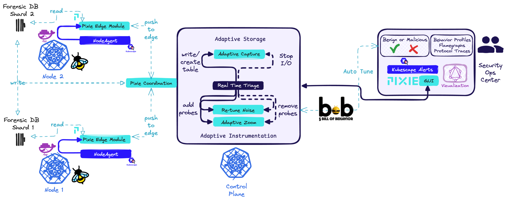

# Kubernetes StormCenter
{: .fs-9 }

Find runtime threats in Kubernetes. Store only the evidence.
{: .fs-6 .fw-300 }

[Install](install.html){: .btn .btn-primary .mr-2 } [Source on GitHub](https://github.com/k8sstormcenter/soc){: .btn }

---

{: .warning }
This is alpha software. The charts and manifests contain alpha builds. Do not use them in production.

Kubernetes StormCenter is a security operations center (SOC) for Kubernetes that runs inside your own cluster. It combines open-source parts that each do one job:

| Part | Job |
|---|---|
| [Kubescape](https://kubescape.io) node-agent | Watches every container with eBPF and raises an alert when a workload does something outside its behavior profile. |
| [Pixie](https://px.dev) | Records recent network traffic, DNS, database protocols, process events and stack traces on each node. |
| Adaptive export and dx | When an alert fires, collect the matching Pixie data for the pods involved and link it into an evidence graph. |
| [ClickHouse](https://clickhouse.com) | Stores the evidence, in your cluster. |
| Pixie cloud | Shows the [cockpit views](cockpit.html) in the browser. |

## Why

- **Your data stays with you.** Everything that is collected is written to ClickHouse in your own cluster.
- **You store evidence, not everything.** Only the data around an alert is written. In three attack scenarios this stored 96.3 % to 99.75 % fewer rows than full export (see [How it works](how-it-works.html#how-much-less-data)).
- **Alerts come with proof.** Each alert leads to the network, process and protocol records that show what happened, or where an attack stopped.

## Get started

1. [Install](install.html) Pixie and the stack on a test cluster.
2. Read [How it works](how-it-works.html) to understand alerts, orders and evidence.
3. Open the [cockpit views](cockpit.html) and start with **Host findings**.
4. If something does not come up, see [Troubleshooting](troubleshooting.html).

The page [Governing agent-written code](adr-harness.html) shows the same stack used for a different purpose: checking whether code written by AI agents keeps a platform team's architecture rules.

## Thanks

This stack builds on the work of the Kubescape and Pixie maintainers. Our changes to both go upstream wherever the maintainers accept them.
